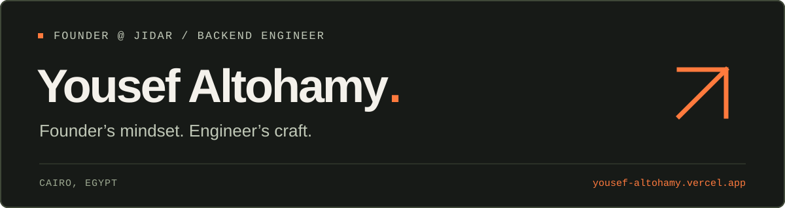

**Founder @ [Jidar](https://jidar0x0.com) · Backend Engineer · Cairo, Egypt**

[Portfolio](https://yousef-altohamy.vercel.app/) · [Jidar](https://jidar0x0.com) · [LinkedIn](https://www.linkedin.com/in/yousefaltohamy/) · [Email](mailto:yousef.altohamy.ahmed@gmail.com)

I build practical products and the backend systems behind them. My work connects business requirements to APIs, data models, authentication, payments, and background processing.

## Currently building: Jidar

I founded **[Jidar](https://jidar0x0.com)** in January 2026, an Egyptian cybersecurity startup focused on making website protection simpler for businesses and developers.

My role combines building the business with hands-on backend engineering: understanding the problem, shaping the product, and turning security requirements into maintainable application workflows.

[Explore Jidar](https://jidar0x0.com) · [GitHub organization](https://github.com/Jidar0x0) · [Follow the journey](https://www.linkedin.com/company/jidar0x0/)

## Engineering focus

- **Clear API boundaries:** validation, authentication, authorization, and predictable responses.
- **Data and business logic:** database relationships, booking workflows, payment states, and background jobs.
- **Reliability:** thoughtful testing, maintainable code, and careful handling of failures and duplicate requests.

## Selected projects

| Project | What I worked on |
| --- | --- |
| [CareerCompass](https://github.com/YousefAlTohamy/CareerCompass) | AI-powered career guidance: CV analysis, skill-gap insights, hybrid job matching, and application tracking. Laravel, MySQL, FastAPI, Docker, and queues. |
| [Huma-Volve Medical Platform](https://github.com/YousefAlTohamy/Huma-volve-Medical-Platform) | Healthcare backend team project: appointments, doctor availability, Stripe **test-mode** payments, chat, and dashboard workflows. Laravel, MySQL, Sanctum, and PHPUnit. |
| [Safarni](https://github.com/YousefAlTohamy/Safarni) | Travel booking backend team project: OTP, Google OAuth, flight search, seat locking, checkout, and passenger management. Laravel, MySQL, and REST APIs. |
| [Ideas](https://github.com/YousefAlTohamy/Ideas) | Social platform backend: ideas, comments, likes, follows, feeds, ownership-based authorization, and queued emails. Laravel, Eloquent, Policies, and queues. |

## Tools I work with

**Core:** PHP · Laravel · MySQL · REST APIs · Authentication & Authorization · Queues

**Development:** Git · GitHub · Docker · GitHub Actions · PHPUnit · Postman

**Supporting technologies used in selected projects:** FastAPI · Python · React · TypeScript

## Background

B.Sc. in Computer Science, **Kafr El-Sheikh University** (2022–2026). Previously a **Backend Developer Intern at Huma-Volve** (December 2025–January 2026).

## Let’s connect

For backend engineering opportunities, product ideas, or a conversation about website security:

**[yousef.altohamy.ahmed@gmail.com](mailto:yousef.altohamy.ahmed@gmail.com)** · [Portfolio](https://yousef-altohamy.vercel.app/) · [LinkedIn](https://www.linkedin.com/in/yousefaltohamy/)
